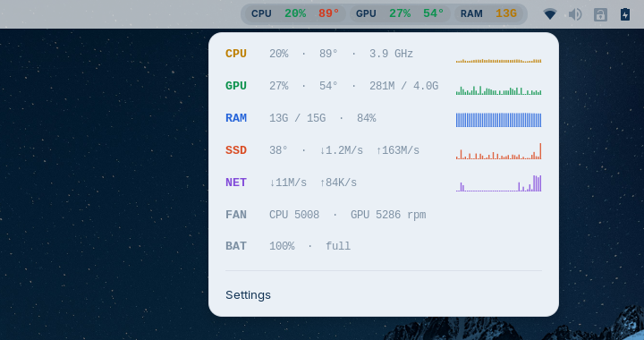

# Pulse Bar

Live CPU, GPU, RAM and temperatures in your GNOME top bar. Click it for a compact panel with live trend graphs, plus disk, network, fan speeds and battery.



- **Always on.** Starts with your session and refreshes every 1.5 s (configurable).
- **Colour-coded.** Values turn yellow, then red, as load or temperature rises. Adapts to light and dark shell themes.
- **Light on resources.** Reads the kernel's own `/proc` and `/sys` files asynchronously. No polling daemons, no network access.
- **Battery-friendly on hybrid-graphics laptops.** A sleeping NVIDIA/AMD GPU is never woken just to read its stats.

## What it shows

| Stat | Source |
|------|--------|
| CPU usage, frequency | `/proc/stat`, `/proc/cpuinfo` |
| CPU temperature | hwmon: `coretemp` (Intel), `k10temp` / `zenpower` (AMD), `cpu_thermal` (ARM), `acpitz` |
| GPU usage, temperature, VRAM | `nvidia-smi` (NVIDIA), sysfs (AMD) |
| RAM | `/proc/meminfo` |
| SSD temperature, read/write speed | hwmon `nvme` / `drivetemp`, `/proc/diskstats` |
| Network speed | `/proc/net/dev` (physical interfaces only) |
| Fan speeds | any hwmon driver exposing `fan*_input` |
| Battery | `/sys/class/power_supply/BAT*` |

Rows your hardware doesn't have are hidden automatically. Intel integrated GPUs don't report usage through a standard interface, so on those machines the GPU section is hidden.

## Requirements

GNOME Shell 45 to 49. That includes Ubuntu 24.04+, Fedora 39+, Zorin OS 18, Debian 13 and Arch.

For NVIDIA GPUs, `nvidia-smi` must be installed (it ships with the proprietary driver).

## Install

```bash
git clone https://github.com/vjymisal0/pulse-bar.git
cd pulse-bar
make install
```

Then **log out and back in** (required on Wayland, where GNOME Shell can't reload itself), and enable it:

```bash
gnome-extensions enable pulse-bar@vjymisal0.github.io
```

To update later: `git pull && make install`, then log out and in.

To uninstall: `gnome-extensions uninstall pulse-bar@vjymisal0.github.io`

## Settings

Click the indicator and choose **Settings**, or run `gnome-extensions prefs pulse-bar@vjymisal0.github.io`.

- Choose which stats appear in the top bar (CPU, GPU, RAM, temperatures, network)
- Position: left, center or right
- Refresh interval
- °C or °F
- Temperature thresholds for yellow and red

## Development

```bash
make test                  # unit tests for the parsers (needs gjs)
gjs -m tests/sensors.live.js   # print one real sample from this machine
make pack                  # build dist/*.shell-extension.zip
```

Layout:

- `extension.js`: panel indicator and dropdown menu
- `prefs.js`: settings window
- `lib/sensors.js`: hardware discovery and async reads
- `lib/parse.js`: pure parsers and formatters (unit-tested)
- `lib/sparkline.js`: the small Cairo bar charts

Bug reports are especially useful if they include the output of `gjs -m tests/sensors.live.js` and `cat /sys/class/hwmon/*/name`.

## License

MIT
